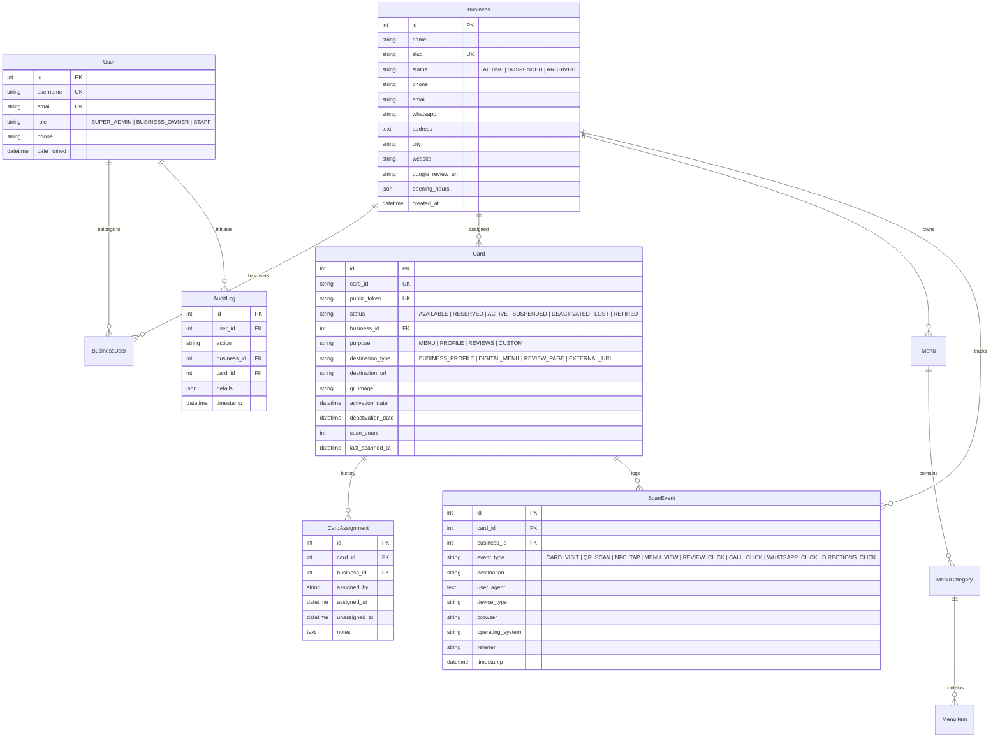

# Database Schema & Entity Relationships

## 1. Schema Overview

The database is built on MySQL using foreign key constraints and indexed lookup tokens.

## 2. Key Constraints & Data Integrity
1. **Uniqueness**:
   - `cards_card.card_id`: Unique alphanumeric ID printed on physical card.
   - `cards_card.public_token`: Unique routing token.
   - `businesses_business.slug`: Unique URL slug.
2. **Safe Card Reassignment**:
   - Card foreign key to `Business` is nullable (`on_delete=models.SET_NULL`).
   - When a card is reassigned, old assignments are recorded in `CardAssignment`, and previous business details are never exposed to future assignees.
3. **Auditing**:
   - `AuditLog` records state transitions (`CARD_ACTIVATED`, `CARD_SUSPENDED`, `CARD_REASSIGNED`).
